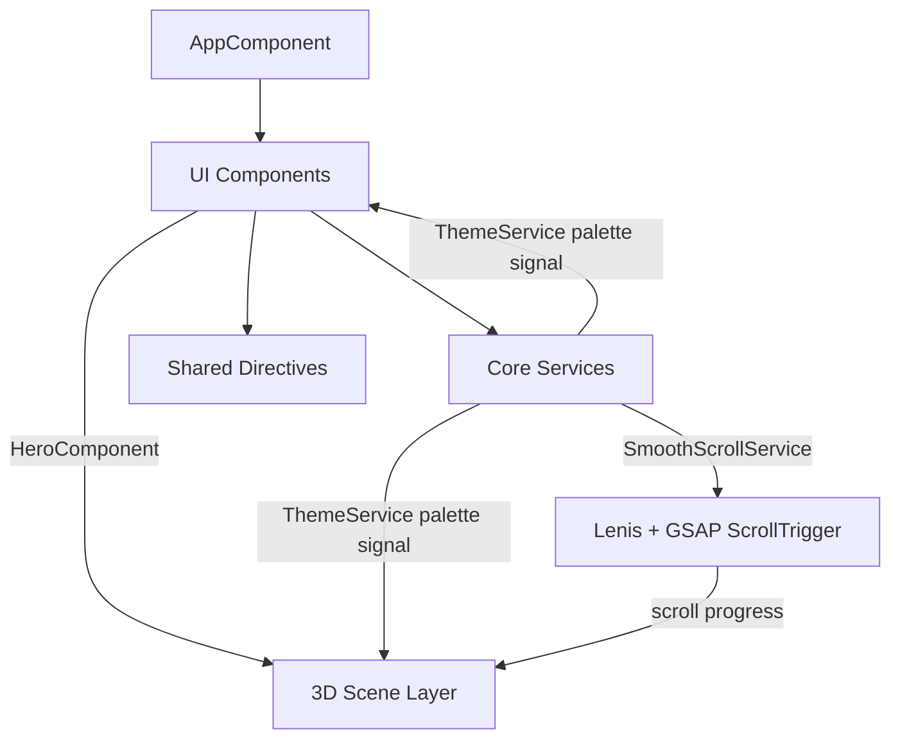

# GELORA — Gelateria

> **Scroll into the scoop.** An immersive, scroll-driven gelateria website where a clay-figurine gelatiere builds a gelato cone in real-time 3D as you scroll.


---

## Table of Contents

1. [Overview](#overview)
2. [Project Objectives](#project-objectives)
3. [Features](#features)
4. [Technologies Used](#technologies-used)
5. [UI/UX Design](#uiux-design)
6. [Project Architecture](#project-architecture)
7. [Installation](#installation)
8. [Getting Started](#getting-started)
9. [Project Structure](#project-structure)
10. [Configuration](#configuration)
11. [Screenshots & Preview](#screenshots--preview)
12. [Video Presentation](#video-presentation)
13. [Performance & Optimization](#performance--optimization)
14. [Responsive Design](#responsive-design)
15. [Security](#security)
16. [Future Improvements](#future-improvements)
17. [Author](#author)
18. [License](#license)

---

## Overview

**GELORA** is a single-page website for a small-batch gelateria, built with **Angular** and **Three.js**. Its centrepiece is a scroll-driven 3D hero: as the visitor scrolls, a handcrafted gelatiere character prepares a gelato in four stages, from placing a waffle cone to finishing it with a crunchy topping.

The entire 3D world (the character, props and shop interior) is generated procedurally in code. The project ships no 3D model files and no image textures, so the scene stays lightweight and every color can be changed at runtime.

Visitors can re-tint the whole experience, both the interface and the 3D scene, through an interactive flavor palette selector.

---

## Project Objectives

- **Tell the product story through interaction.** Turn the act of scrolling into watching a gelato being made.
- **Deliver a premium, tactile aesthetic.** Use warm tones, editorial serif typography, soft lighting and a clay-figurine look.
- **Let the visitor personalise the experience.** Provide a dynamic color system that drives both CSS and WebGL materials.
- **Stay smooth and accessible.** Run heavy rendering outside Angular's change detection, adapt quality to the device and respect reduced-motion preferences.
- **Keep the codebase maintainable.** Use reusable standalone components, shared directives, typed data and a framework-independent 3D layer.

---

## Features

### Scroll-driven 3D story

The hero section is a tall scroll area with a sticky WebGL canvas. Scroll progress drives a four-step choreography:

| Step | Title | What happens in the scene |
| :---: | --- | --- |
| 01 | **The Cone** | The gelatiere carries a waffle cone and seats it in a wire stand. |
| 02 | **The Scoop** | He walks to the gelato pan, leans in, scoops with a long-handled scoop and drops the scoop onto the cone. |
| 03 | **The Dip** | A copper jug pours a stream of chocolate that coats the scoop from the top down and forms drips. |
| 04 | **The Crunch** | Pistachio pieces fall from his fingers and settle on the chocolate shell. He finishes with a presenting gesture. |

### The 3D character and scene

- **Procedural gelatiere.** Built from primitives with a clay-like physical material: apron, bow tie, paper cap and mustache.
- **Two-bone inverse kinematics (IK).** His hands reach props anywhere in the scene.
- **Procedural body motion.** A walk cycle, forward lean, breathing, head tracking with neck limits, and periodic blinking.
- **Custom chocolate shader.** Injected through `onBeforeCompile`, it reveals the chocolate shell with a wavy, poured edge.
- **Instanced pistachio pieces.** Each piece falls on its own staggered path onto the scoop surface.
- **Camera path.** A Catmull-Rom spline path with subtle pointer parallax and idle drift.
- **Shop environment.** A terrazzo counter, a display case with gelato tubs, shelves with bottles, display cones, pendant lamps and plants.

### Interface

- **Step rail and dots.** A step rail with progress fill, clickable step nodes and pagination dots that jump to each stage.
- **Step copy.** The description text changes with each step, and the flavor card adapts to the active palette.
- **Preloader.** It counts up while the 3D stage prepares and lifts away with a curtain transition once the first frame renders.
- **Fixed navigation.** It turns to frosted glass when you scroll and hides as you scroll down past the hero. It includes a full-screen animated menu.
- **Flavor palette selector.**
  - Six preset palettes: Pistachio Crunch, Strawberry Silk, Mango Sunset, Blueberry Cloud, Fior di Latte and Midnight Cacao (dark).
  - A free color picker, a hex input field and a "Surprise me" random palette.
- **Content sections:**
  - A scroll-velocity-reactive marquee.
  - Flavor cards with 3D tilt and glare.
  - A pinned horizontal "Craft" section with count-up statistics.
  - A word-by-word scroll reveal for the story.
  - A visit and order section with a validated reactive form.
  - A footer.
- **Micro-interactions.** Magnetic buttons, a custom trailing cursor (on fine-pointer devices only) and an animated film-grain overlay.

---

## Technologies Used

| Category | Technology | Version | Purpose |
| --- | --- | --- | --- |
| Framework | [Angular](https://angular.dev) | 19.2 | Standalone components, signals, control flow, reactive forms |
| Language | TypeScript | 5.7 | Strict typing, with strict templates enabled |
| 3D rendering | [Three.js](https://threejs.org) | 0.170 | WebGL renderer, physical materials, shadows, post-processing |
| Animation | [GSAP](https://gsap.com) + ScrollTrigger | 3.12.5 | Scroll-linked timelines, reveals, pinning, palette tweening |
| Smooth scrolling | [Lenis](https://lenis.darkroom.engineering) | 1.1.18 | Inertial scrolling synchronised with GSAP's ticker |
| Reactive utilities | RxJS | 7.8 | Angular dependency |
| Styling | SCSS + CSS custom properties | — | Design tokens and runtime theming |
| Typography | Google Fonts: *Fraunces* & *Manrope* | — | Display serif and body sans-serif |
| Tooling | Angular CLI (`@angular-devkit/build-angular`) | 19.2 | Development server and production builds |

**Three.js add-ons used:**
- `RoomEnvironment` for image-based lighting
- `EffectComposer` with `RenderPass`, `BokehPass` and `OutputPass`
- `BufferGeometryUtils.mergeVertices`

---

## UI/UX Design

### Visual language

- **Palette.** Warm cream and beige backgrounds, deep ink text, and a golden accent for primary actions. Every token is a CSS custom property, so it can be swapped at runtime.
- **Typography.** *Fraunces* is set in uppercase for display headings, giving an editorial, artisanal tone. *Manrope* is used for body copy and labels.
- **Materials.** A clay-figurine aesthetic using a physically based material with sheen and a procedural fingerprint-like bump texture.
- **Photographic finish.** ACES filmic tone mapping, soft shadows, a depth-of-field blur on desktop, a vignette and a subtle animated grain.

### Interaction principles

- **Scroll is the primary control.** The 3D scene eases towards the scroll position for smooth, weighty motion.
- **Every step can be reached directly.** Use the rail nodes, the pagination dots or the "next" button.
- **Motion has meaning.** Text rises from masks, cards respond to the pointer, and buttons are gently magnetic.
- **The color selector is visible on every page.** It sits in the navigation. Choices persist between visits, and selecting a flavor card scrolls back to the hero to show that flavor being made.

### Accessibility considerations

- Semantic landmarks (`header`, `nav`, `main`, `section`, `footer`) and visible focus outlines.
- ARIA attributes on interactive controls: `aria-expanded`, `aria-current`, `aria-checked`, `aria-live` on changing step text, and labelled icon buttons.
- Split-text elements keep their full text in an `aria-label`, and decorative elements are hidden from assistive technology.
- `prefers-reduced-motion` disables smooth-scroll inertia and shortens CSS animations.
- If WebGL is unavailable, the page falls back gracefully and the interface still tells the story.

---

## Project Architecture

The application is organised into four layers with clear responsibilities.



| Layer | Location | Responsibility |
| --- | --- | --- |
| **Core** | `src/app/core` | Application-wide state and services: theming (`ThemeService`), smooth scrolling (`SmoothScrollService`), app state signals (`AppStateService`) and typed content data. |
| **Components** | `src/app/components` | Standalone, `OnPush` UI components, one per page section or widget. |
| **Shared directives** | `src/app/shared/directives` | Reusable behaviours: scroll reveal, split-text animation, 3D tilt, magnetic hover. |
| **Scene** | `src/app/scene` | Framework-independent Three.js code. `GelatoScene` exposes a small API (`setProgress`, `setPointer`, `setPalette`, `setActive`, `resize`, `dispose`) that the hero component calls. |

### Key design decisions

- **Signals for state.** The palette, scene readiness, intro completion and menu state are Angular signals. Effects push palette changes to both the DOM (CSS variables) and the WebGL scene.
- **Zone-less hot paths.** The render loop, scroll handlers, pointer tracking and GSAP animations run inside `NgZone.runOutsideAngular`. Angular change detection is triggered only when the active step actually changes.
- **Decoupled 3D layer.** The scene classes do not import Angular, so they can be tested, reused or ported independently.

---

## Installation

### Prerequisites

| Tool | Version |
| --- | --- |
| [Node.js](https://nodejs.org) | `^18.19.1`, `^20.11.1` or `^22.0.0` (Angular 19 requirement) |
| npm | Bundled with Node.js |
| Browser | A modern browser with WebGL 2 support |

### Steps

```bash
# 1. Move into the project folder
cd gelora

# 2. Install dependencies
npm install
```

---

## Getting Started

### Development server

```bash
npm start
```

Open [http://localhost:4200](http://localhost:4200). The application reloads automatically when source files change.

To use a different port:

```bash
npm start -- --port 4300
```

### Production build

```bash
npm run build
```

The optimised output is written to `dist/gelora/browser`. It is a static bundle that any static web server can host.

### Available scripts

| Command | Description |
| --- | --- |
| `npm start` | Runs `ng serve`, the development server with live reload. |
| `npm run build` | Runs `ng build`, a production build with hashed output files. |
| `npm run watch` | Rebuilds in development mode whenever files change. |
| `npm test` | Runs `ng test`, the Karma test runner. No test specs are included yet. |

---

## Project Structure

```
gelora/
├── public/
│   ├── favicon.ico
│   └── favicon.svg                  # GELORA cone icon
├── src/
│   ├── index.html                   # Meta tags, fonts, root element
│   ├── main.ts                      # Application bootstrap
│   ├── styles.scss                  # Design tokens, base styles, buttons, grain, split-text helpers
│   └── app/
│       ├── app.component.ts         # Page composition
│       ├── app.config.ts            # Application providers
│       ├── core/
│       │   ├── app-state.service.ts # sceneReady, introDone, menuOpen signals
│       │   ├── data/content.ts      # Steps, navigation, craft and story copy
│       │   ├── scroll/smooth-scroll.service.ts
│       │   └── theme/
│       │       ├── palettes.ts      # Palette presets + HSL helpers + custom palette generator
│       │       └── theme.service.ts # Applies CSS variables, persists the selection
│       ├── scene/
│       │   ├── gelato-scene.ts      # Renderer, lights, camera path, scroll choreography
│       │   ├── character.ts         # Gelatiere rig: IK arms, walk, head tracking, blinking
│       │   ├── props.ts             # Materials, cone, stand, scoop geometry, tools, trays
│       │   ├── environment.ts       # Shop interior
│       │   ├── textures.ts          # Procedural canvas textures
│       │   └── util.ts              # Easing, damping, noise, seeded RNG
│       ├── components/
│       │   ├── loader/              # Preloader with progress counter
│       │   ├── nav/                 # Header, links, full-screen menu
│       │   ├── color-picker/        # Flavor palette selector
│       │   ├── hero/                # Sticky 3D stage + overlay UI
│       │   ├── marquee/             # Velocity-reactive ticker
│       │   ├── flavors/             # Flavor cards
│       │   ├── craft/               # Pinned horizontal process section
│       │   ├── story/               # Scroll-scrubbed story text
│       │   ├── visit/               # Opening hours + order form
│       │   ├── footer/
│       │   ├── cursor/              # Custom cursor
│       │   └── cone-art/            # Tintable SVG cone illustration
│       └── shared/directives/
│           ├── reveal.directive.ts
│           ├── split-text.directive.ts
│           ├── tilt.directive.ts
│           └── magnetic.directive.ts
├── angular.json
├── package.json
└── tsconfig*.json
```

---

## Configuration

### Color palettes

Palettes are defined in `src/app/core/theme/palettes.ts`. Each entry implements the `Palette` interface:

```ts
{
  id: 'pistachio',
  flavor: 'Pistachio Crunch',
  notes: 'Bronte pistachio, toasted nibs, a pinch of sea salt.',
  price: '€4.80',
  gelato: '#b8c98a',   // scoop color (UI + 3D)
  accent: '#e9c46a',   // buttons, highlights, progress rail
  accentInk: '#2f2a22',// text on accent
  apron: '#3f5b45',    // character apron in 3D
  bg: '#e8dcc8',
  bgDeep: '#d6c5a8',
  ink: '#2f2a22',
  dark: false,
}
```

To add a flavor, append a new object to `PALETTES`. It then appears automatically in the palette selector, the flavor grid and the order form. The visitor's selection is stored in `localStorage` under the key `gelora.palette`.

### Content

All copy lives in `src/app/core/data/content.ts`:

- `STEPS`: the four hero stages
- `NAV_LINKS`: navigation entries
- `CRAFT`: the process panels and statistics
- `STORY`: the story paragraph

### 3D stage and choreography

| What to change | Where |
| --- | --- |
| Prop positions (cone, pan, bowl, nut tray) | Constants at the top of `scene/gelato-scene.ts` |
| Camera keyframes | `CAM_KEYS` in `scene/gelato-scene.ts` (progress, position, look target) |
| Animation timing | `choreograph()` in `scene/gelato-scene.ts`. Each action uses a progress window such as `k(p, 0.06, 0.17)`. |
| Character proportions | `scene/character.ts` (arm lengths `L1` and `L2`, root scale) |
| Lighting and post-processing | `addLights()` and `setupComposer()` in `scene/gelato-scene.ts` |

### Build budgets

Three.js makes the initial bundle larger than a typical Angular application, so the production budgets in `angular.json` are raised to the following values:

| Budget | Warning | Error |
| --- | --- | --- |
| Initial bundle | 1.5 MB | 3 MB |
| Component styles | 16 kB | 32 kB |

---

## Screenshots & Preview

No screenshots are committed to the repository yet. To add them, save the images in a `docs/screenshots/` folder and reference them here, for example:

```markdown

```

Suggested captures:

- Each of the four hero steps.
- The palette selector open.
- The Midnight Cacao dark palette.
- The flavor grid.
- The mobile layout.

---

## Video Presentation

No video presentation is included in the repository yet. Once a walkthrough recording exists, add its link or embed it in this section.

---

## Performance & Optimization

| Technique | Implementation |
| --- | --- |
| Rendering outside Angular | The render loop, scroll handlers and pointer handlers run outside `NgZone`. The UI updates only when the active step changes. |
| Off-screen pause | An `IntersectionObserver` stops the render loop when the hero leaves the viewport. |
| Adaptive quality | On narrow screens or coarse pointers: a pixel ratio capped at 1.5, a 1024 px shadow map, lower scoop geometry detail and no post-processing. Desktop uses a pixel ratio of up to 2, a 2048 px shadow map and multisampled bokeh post-processing. |
| Procedural assets | Textures are drawn on canvas and geometry is generated in code, so there are no model or image downloads for the scene. |
| Instancing | The pistachio pieces are drawn with `InstancedMesh`, one draw call per batch. |
| Frame-rate independence | Exponential damping and a clamped delta time keep the motion consistent across devices. |
| Resource cleanup | `GelatoScene.dispose()` releases geometries, materials, textures, the composer and the renderer. ScrollTriggers and listeners are removed through `DestroyRef`. |
| Change detection | Every component uses `ChangeDetectionStrategy.OnPush`. |
| Production build | Angular's optimised build with hashed output files. Initial transfer size is about 240 kB (compressed estimate). |

---

## Responsive Design

The layout adapts at several breakpoints. On top of the CSS changes, the 3D camera recomputes its framing from the viewport's aspect ratio:

| Viewport | Layout behaviour |
| --- | --- |
| **Desktop** (landscape) | The copy sits on the left and the 3D stage is offset to the right. Step labels show on the rail, and the "Craft" section uses pinned horizontal scrolling. |
| **Tablet** | Intermediate camera framing. The flavor grid drops to two columns, and the navigation links collapse into the menu below 960 px. |
| **Mobile** (portrait) | The headline sits at the top and the stage is framed in the lower half. The step rail is compact, the flavor grid is a single column, "Craft" panels stack vertically, and the palette panel spans the screen width. |

Other responsive details:

- Fluid typography with `clamp()`.
- `100svh` units so that mobile browser toolbars don't break the layout.
- A safe-area-aware viewport meta tag.
- The custom cursor and hover effects are enabled only on devices with a fine pointer.

---

## Security

GELORA is a static, client-side application with no backend.

- **No data leaves the browser.** The order form validates its input with Angular reactive forms and shows a local confirmation. It does not transmit or store personal data.
- **Local storage holds only the palette choice.** It stores just the palette ID or a validated hex value (`/^#[0-9a-f]{6}$/i`). Reads and writes are wrapped in `try/catch`.
- **Template safety.** Angular's built-in sanitisation and strict template type-checking (`strictTemplates`) are enabled.
- **External links.** They use `rel="noopener"`.
- **Third-party origins.** Apart from npm dependencies bundled at build time, the only external resources are Google Fonts.

> If a real ordering backend is added later, implement server-side validation, HTTPS-only communication, rate limiting and a Content Security Policy.

---

## Future Improvements

- Connect the order form to a real backend or ordering service.
- Add unit tests for services and directives, and end-to-end tests for the scroll story.
- Add internationalisation, for example English and Italian, with Angular i18n.
- Lazy-load the Three.js scene to reduce the initial bundle size.
- Add audio feedback (scoop, pour, crunch) with a mute toggle.
- Offer an optional higher-fidelity mode with authored 3D models.
- Add the screenshots and the video presentation to this README.

---

## Author

**Dhia Saied**

---

## License

No license has been specified for this project yet. Until a license file is added, all rights are reserved by the author.
